<!-- ═══════════════════════════════ HEADER ═══════════════════════════════ -->
<div align="center">


<a href="https://kshitijraj.dev">
  
</a>

<br/><br/>

<a href="https://kshitijraj.dev"></a>
<a href="https://app.hackthebox.com/profile/355204"></a>
<a href="https://linkedin.com/in/kshitij-raj-23245319a"></a>
<a href="https://x.com/kr45_real"></a>
<a href="https://instagram.com/kr91323"></a>
<a href="mailto:kr91323@gmail.com"></a>

<br/><br/>


</div>

<br/>

<div align="center">
  
</div>

<br/>

<!-- ═══════════════════════════════ ABOUT ═══════════════════════════════ -->
<table>
<tr>
<td width="60%" valign="top">

### `> cat about_me.yml`

```yaml
name:      Kshitij Raj
handle:    kr45
role:      Security Researcher & Pentester
focus:
  - Web Application Security
  - Cloud Security (AWS / GCP)
  - Network Penetration Testing
  - CTFs & Hack The Box
currently: Hunting bugs & writing about them
motto:     "If it's connected, it's a target."
```

🛡️ I break applications and infrastructure so they can be rebuilt stronger.<br/>
✍️ Write-ups and research on **[kshitijraj.dev](https://kshitijraj.dev)**<br/>
🤝 Open to security research collabs and CTF teams.

</td>
<td width="40%" align="center" valign="middle">


</td>
</tr>
</table>

<!-- ═══════════════════════════════ INTERACTIVE SHELL ═══════════════════════════════ -->
## 🖥️ kr45@kali:~$ <sub><sup>`click a command to run it`</sup></sub>

<details>
<summary><code>kr45@kali:~$ ls -la ~/arsenal</code></summary>
<br/>
<div align="center">

**Offensive Security**<br/>


**Languages**<br/>


**Cloud & DevOps**<br/>


</div>
</details>

<details>
<summary><code>kr45@kali:~$ tail -n 5 ~/blog/writeups.log</code></summary>
<br/>

<!-- BLOG-POST-LIST:START -->
<!-- BLOG-POST-LIST:END -->

➡️ More at **[kshitijraj.dev](https://kshitijraj.dev)**

</details>

<details>
<summary><code>kr45@kali:~$ nmap -sV kr45 --top-ports 5</code></summary>
<br/>

```text
Starting Nmap scan against kr45 ...
PORT      STATE  SERVICE     VERSION
443/tcp   open   website     https://kshitijraj.dev
1337/tcp  open   hackthebox  https://app.hackthebox.com/profile/355204
8080/tcp  open   linkedin    https://linkedin.com/in/kshitij-raj-23245319a
6667/tcp  open   x-twitter   https://x.com/kr45_real
25/tcp    open   smtp        kr91323@gmail.com

Nmap done: 1 host up — all ports open for collaboration 🤝
```

</details>

<details>
<summary><code>kr45@kali:~$ sudo rm -rf / --no-preserve-root</code></summary>
<br/>

```text
[sudo] password for kr45: ********
Sorry, try again.
Nice try 😏 — kr45 is not in the sudoers file. This incident will be reported.
```

</details>

<!-- ═══════════════════════════════ STATS ═══════════════════════════════ -->
## 📊 GitHub Activity

<div align="center">


</div>

<!-- ═══════════════════════════════ FOOTER ═══════════════════════════════ -->
<br/>

```bash
┌──(kr45㉿kali)-[~]
└─$ echo "Thanks for stopping by — stay curious, stay ethical."
Thanks for stopping by — stay curious, stay ethical.
```


